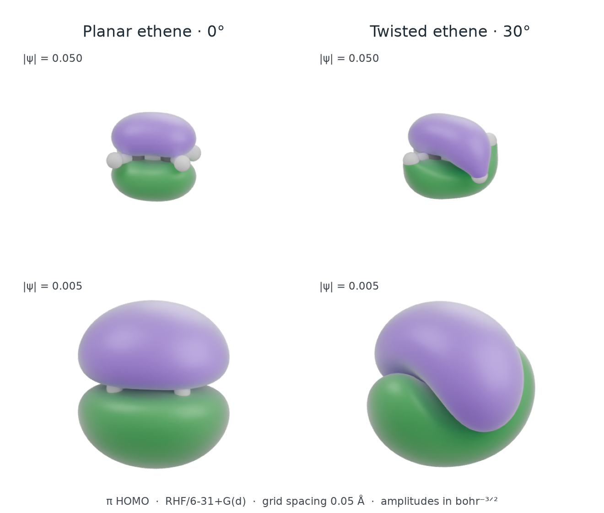

# Planar and twisted ethene π HOMO

Both neutral singlet structures use spherical RHF/6-31+G(d) from PySCF 2.11.0.
The C=C axis lies along x. Rotating the right CH₂ group by 30° holds its bond
lengths and angles fixed. These are prescribed geometries. Orbital 8 is the
HOMO in both. It has the largest overlap with the planar π HOMO among all
twisted orbitals (0.864158 after phase alignment).

Run `python generate.py` in an environment with PySCF, NumPy and SciPy to
regenerate the two Molden files and four reference tables. The Molden files
retain all eight occupied orbitals. The tables use PySCF's native spherical AO
values contracted with its SCF coefficients, independently of the Molden export.
The phase convention makes the planar HOMO positive above the left carbon and
the overlap between the two geometries positive.

The sample tables contain the node and points 0.001 bohr above and below it,
plus points out to ±8 bohr on three vertical lines. The crossing tables give
the outer z roots of the continuous PySCF field at ±0.05 and ±0.005 bohr⁻³ᐟ²
on those same lines. All table coordinates are in bohr.

The [regression tests](../../test_ethene_orbitals.py) exercise both evaluators
at the signed probes. In Blender they check the meshes produced by the importer
at 0.12 Å spacing. Each sign and magnitude must have one closed component, lie
inside the sampled box, and intersect the reference lines at the expected depths.
The tests run from the checked-in data without PySCF.

## Precision measurements

Run `python3 benchmarks/orbital_precision.py` from the repository root. The
[benchmark](../../../benchmarks/orbital_precision.py) builds three temporary
versions of both the AO and marching-cubes kernels with the same compiler and
-O3. It compares float32 with and without fast math, then strict float32
with strict float64. Only the kernel arithmetic and buffers are widened.
The imported coefficients, sampling lattice, shell screening policy and final
Blender vertex precision are shared across builds. The comparison uses the
largest nearest-vertex distance in either direction between the two meshes.

Local Apple Silicon results with Apple Clang 21, across both geometries, both
signs and both absolute levels. The PySCF column compares the production
fast-math mesh with 24 independently solved outer crossings.

| Grid spacing | Fast math on/off, max vertex distance | Strict float32/64, max vertex distance | Max outer crossing error vs PySCF |
|---|---:|---:|---:|
| 0.10 Å | 0.0000496 Å | 0.0000356 Å | 0.00327 Å |
| 0.05 Å | 0.0000195 Å | 0.0000140 Å | 0.000581 Å |

All three builds produced the same triangle count for every contour at each
spacing. With the normal shell screening threshold of 10⁻⁶, the largest point
error in either production evaluator was 1.64 × 10⁻⁸ bohr⁻³ᐟ² for planar
ethene and 9.94 × 10⁻⁷ for twisted ethene. The latter occurred at z = 8 bohr
in the tail. Tightening screening to 10⁻¹² in the float32 comparison reduced
the twisted maximum below 2 × 10⁻⁸. At these levels and resolutions, grid
spacing had the larger effect on the displayed surface.

As a separate check on the original clipping example, Blender 4.3.2 imported
the manuscript's `phenanthroline_pbe0.molden` and built orbitals 46–49 at
±0.05 and ±0.005 with 0.08 Å spacing and remeshing off. Every edge of all
16 signed meshes had two incident faces. The nearest mesh vertex to a sampling
box face was 3.016 Å inside it. This check used the supplied local manuscript file.
